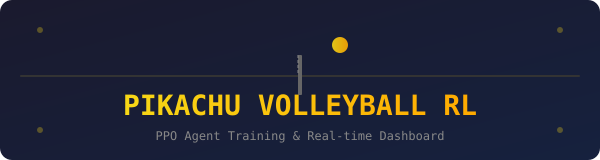

<p align="center">
  
</p>

<h1 align="center">Pikachu Volleyball RL</h1>

<p align="center">
  <strong>2D 피카추 배구 + 강화학습(PPO) 훈련 + 실시간 웹 대시보드</strong>
</p>

<p align="center">
  <a href="https://github.com/shyoon-devops/pikachu-volleyball-rl/actions"></a>
  
  
  
  
  
</p>

<p align="center">
  <a href="#quick-start">Quick Start</a> &bull;
  <a href="#architecture">Architecture</a> &bull;
  <a href="#key-features">Features</a> &bull;
  <a href="CHANGELOG.md">Changelog</a> &bull;
  <a href="docs/PLAN.md">Spec</a>
</p>

---

PPO 에이전트가 Rule-based Bot(L1~L5)을 상대로 피카추 배구를 학습합니다. 웹 대시보드에서 훈련을 제어하고, 실시간 게임과 메트릭을 관찰하며, 리플레이를 재생하고, 모델 버전을 비교 평가할 수 있습니다.

> Inspired by the original [Pikachu Volleyball](https://github.com/gorisanson/pikachu-volleyball) (1997).

**Status**: v0.1.0 production · v0.2.0 QA tagged · **v0.2.1 dev-tagged, QA re-promoted, prod-대기** — see [sprint tracker](docs/sprint-tracking/sprint1-v0.2.1.md) and [deployment status](docs/DEPLOYMENT-STATUS.md). Sprint 2 (v0.2.2) 착수: [docs/SPRINT2-STATUS.md](docs/SPRINT2-STATUS.md).

## Quick Start

```bash
git clone https://github.com/shyoon-devops/pikachu-volleyball-rl.git
cd pikachu-volleyball-rl
cp .env.example .env
docker compose up --build
```

| Service | URL |
|---------|-----|
| Dashboard | http://localhost:5173 |
| API Docs | http://localhost:8000/docs |
| Backend | http://localhost:8000 |

## Architecture

**Two-server split** (since v0.2.1, commit `75fb4292`): frontend serves from a separate nginx host and reverse-proxies API/WS to the GPU server. Docker Compose 파일에서 `frontend` 서비스 제거.

```
┌─────────────────────────────────────────┐      ┌─────────────────────────────────────────┐
│   yoonbian-2 (192.168.0.248)            │      │   GPU server (192.168.0.250)            │
│   ─────────────────────────────         │      │   ─────────────────────────────         │
│   nginx (static + reverse proxy)        │◀────▶│   Backend (FastAPI)                     │
│   Built frontend (React 19 / Vite)      │      │   REST · WebSocket Hub · Services       │
│   :3000 dev  ·  :3001 qa  ·  :5173 prod │      │   :8001 dev · :8002 qa · :8000 prod     │
│                                         │      │   ┌──────────────────────────────────┐  │
│   PixiJS canvas  ·  Recharts  ·  WS     │      │   │ Game Engine (Pure Python)        │  │
│   Dashboard · Replay · Evaluation       │      │   │ Physics · Bot L1-L5 · Gym 18D/12A│  │
│                                         │      │   └──────────────────────────────────┘  │
│                                         │      │   ┌──────────────────────────────────┐  │
│                                         │      │   │ RL Pipeline (SB3 PPO)            │  │
│                                         │      │   │ Trainer · Evaluator · Callbacks  │  │
│                                         │      │   └──────────────────────────────────┘  │
│                                         │      │            │                            │
│                                         │      │   ┌────────┴─────────┐                  │
│                                         │      │   │ MongoDB 7 (motor)│                  │
│                                         │      │   │ :27018/27019/    │                  │
│                                         │      │   │ 27017 per env    │                  │
│                                         │      │   └──────────────────┘                  │
└─────────────────────────────────────────┘      └─────────────────────────────────────────┘
```

Nginx configs: `frontend/nginx-dev.conf`, `frontend/nginx-qa.conf`, `frontend/nginx-prod.conf` (per-env API/WS upstream).
Frontend 배포: `scripts/deploy-frontend.sh` — 로컬 빌드 후 yoonbian-2 rsync + nginx reload.

## Tech Stack

| Layer | Technology |
|-------|-----------|
| Backend | Python 3.11+ / FastAPI / Uvicorn |
| RL | Stable-Baselines3 (PPO) / Gymnasium |
| Frontend | React 19 / TypeScript / PixiJS 8 / Vite 8 |
| Charts | Recharts |
| Real-time | WebSocket |
| Database | MongoDB 7 (motor async) |
| Deploy | Docker Compose / GitHub Actions CI/CD |
| Testing | pytest / Vitest |

## Key Features

**Game Engine** — Physics-based 2D volleyball with collisions, gravity, net, 15-point scoring. Five difficulty bot levels (L1 beginner ~ L5 perfect).

**RL Training** — PPO via SB3 with curriculum learning (bot difficulty ramps up). 8 parallel SubprocVecEnv. Real-time metric streaming over WebSocket.

**Web Dashboard** — Live game visualization (PixiJS, 30→60fps interpolation). Training controls, metric charts, replay player with seek/speed, model evaluation panel.

**Multi-Environment** — dev/qa/prod split across two hosts. Backend + MongoDB on GPU server via Docker Compose, frontend served via nginx on yoonbian-2.

| Environment | Backend (GPU, 192.168.0.250) | Frontend (yoonbian-2, 192.168.0.248) | MongoDB |
|-------------|------------------------------|---------------------------------------|---------|
| dev | :8001 | http://192.168.0.248:3000 | :27018 |
| qa | :8002 | http://192.168.0.248:3001 | :27019 |
| prod | :8000 | http://192.168.0.248:5173 | :27017 |

## Local Development

**Backend:**
```bash
cd backend && pip install -e ".[dev]"
uvicorn app.main:app --reload --port 8000
```

**Frontend:**
```bash
cd frontend && npm install && npm run dev
```

**MongoDB only:**
```bash
docker compose up mongodb
```

## Project Structure

```
backend/
  game/         Physics engine, bot, constants
  rl/           Gymnasium env, PPO trainer, evaluator, callbacks
  app/          FastAPI server (api/, ws/, services/, models/)
  tests/        pytest (10 modules)
frontend/src/
  components/   dashboard/ game/ replay/ evaluation/
  hooks/        useWebSocket, useTrainingState
  styles/       Design tokens, global CSS
scripts/        deploy, promote, release, status
docs/           Specs, workflow, proposals, releases
```

## Testing

```bash
cd backend && pytest tests/ -v --cov    # Backend
cd frontend && npm run test              # Frontend
```

## Deployment

Two-server workflow — backend + MongoDB 은 GPU 서버 Docker Compose, frontend 는 yoonbian-2 nginx 정적 서빙.

```bash
# Backend (GPU server)
scripts/deploy-dev.sh            # backend compose up (dev)
scripts/deploy-qa.sh             # backend compose up (qa)
scripts/deploy-prod.sh           # backend compose up (prod)

# Frontend (from any machine that can reach yoonbian-2 via SSH)
scripts/deploy-frontend.sh dev   # build + rsync → yoonbian-2:/var/www/...
scripts/deploy-frontend.sh qa
scripts/deploy-frontend.sh prod

# Promotion + release
scripts/promote.sh dev-to-qa     # dev → qa (git)
scripts/promote.sh qa-to-prod    # qa → prod (git)
scripts/release.sh 0.2.1         # Version tag + changelog
scripts/status.sh                # Environment status
```

Prod 승격 후에는 반드시 `main` 브랜치로 머지하고 `v0.X.Y` 태그를 `main` HEAD 에 유지해야 합니다 — [docs/WORKFLOW.md](docs/WORKFLOW.md) 참조.

## Team

| Role | Scope |
|------|-------|
| AI Engineer | Game engine, bot, RL environment |
| Trainer | PPO training pipeline, callbacks |
| Evaluator | Model evaluation, comparison |
| Backend Engineer | FastAPI, WebSocket, MongoDB |
| Frontend Engineer | React UI, hooks, API client |
| Designer | CSS design system, arcade theme |
| DevOps Engineer | Docker, CI/CD, deployment |
| QA Engineer | Test suite (unit, integration, scenario) |
| Product Manager | Versioning, docs, releases, GitHub |

## Contributing

See [CONTRIBUTING.md](CONTRIBUTING.md) for development workflow.

## License

This project is for educational and research purposes.

---

<p align="center">
  <sub>v0.2.1 &bull; <a href="CHANGELOG.md">Changelog</a> &bull; <a href="docs/DEPLOYMENT-STATUS.md">Deployment Status</a></sub>
</p>
